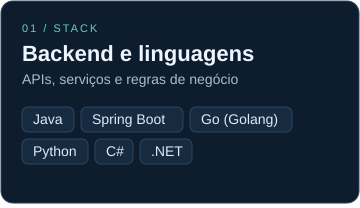
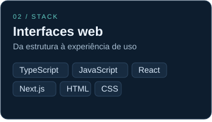
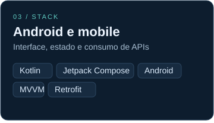
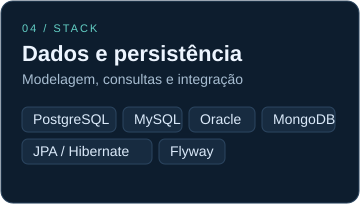
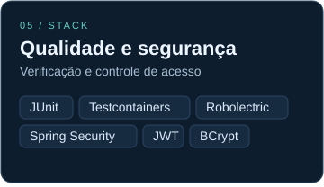
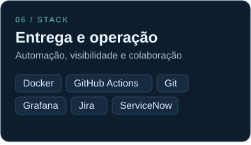

<picture>
  <source media="(max-width: 600px)" srcset="./assets/hero-mobile.svg"/>
  
</picture>

  <a href="#sobre-mim">Sobre</a> &nbsp;·&nbsp;
  <a href="#ecossistema-técnico">Tecnologias</a> &nbsp;·&nbsp;
  <a href="#projetos-selecionados">Projetos</a> &nbsp;·&nbsp;
  <a href="#formação-e-evolução">Formação</a> &nbsp;·&nbsp;
  <a href="https://www.linkedin.com/in/kelvin-wendell-barboza-da-silva-4765a8216/">LinkedIn ↗</a>

## Sobre mim

Sou **Kelvin Wendell, engenheiro de software júnior na Aceleraí** e estudante de **Análise e Desenvolvimento de Sistemas na FIAP**. Meu interesse pela engenharia está na conexão entre o problema de negócio e as decisões que tornam uma solução útil: como organizar o domínio, conectar serviços, proteger o acesso e manter o sistema compreensível para quem vai evoluí-lo depois.

No trabalho, contribuo para o desenvolvimento e aprimoramento de soluções administrativas. Essa experiência tem ampliado meu olhar para **estabilidade, eficiência e experiência de uso**, além da implementação de funcionalidades. Procuro entender quem utiliza o sistema, quais regras precisam ser respeitadas e como uma alteração se comporta no restante da aplicação.

Minha principal base de desenvolvimento é **Java e Spring Boot**, com construção e consumo de APIs REST, persistência e segurança. Também exploro o desenvolvimento full stack com **TypeScript, React e Next.js**, aplicações Android com **Kotlin e Jetpack Compose**, e amplio meu repertório com **Go, Python e C#/.NET**.

Nos projetos, gosto de tornar as escolhas técnicas verificáveis. No **Águia Inova**, isso aparece no controle de acesso por perfil, nos testes com banco real e na integração de IA com alternativas por regras para os fluxos que suportam essa opção. Na **API de Mobilidade Sustentável**, aparece na modelagem relacional, nas validações e no versionamento do banco com Flyway.

### Como penso e trabalho

- **Contexto antes da implementação.** Entender usuários, regras e restrições para escolher uma solução proporcional ao problema.
- **Responsabilidades claras.** Separar domínio, integração e interface para facilitar manutenção e evolução.
- **Qualidade ao longo da entrega.** Verificar regras de negócio, contratos e permissões, além do caminho em que tudo funciona.
- **IA com critério.** Usar modelos como apoio à análise e ao desenvolvimento, revisando suas saídas e preservando a decisão humana.
- **Aprendizado compartilhado.** Discutir alternativas, investigar falhas e transformar a troca com a equipe em melhoria contínua.

<b>Read in English</b>

I'm Kelvin Wendell, a junior software engineer at Aceleraí and a Systems Analysis and Development student at FIAP. I contribute to administrative software and care about how business rules, security, stability and usability come together in a product.

My main development foundation is Java and Spring Boot. I also explore full stack development with TypeScript, React and Next.js, Android with Kotlin and Jetpack Compose, and broaden my toolkit with Go, Python and C#/.NET.

In my projects, I aim to make engineering choices explicit: role-based authorization, integration tests with a real database, versioned database migrations and AI integrations that keep people in control. I value clear responsibilities, collaboration and continuous learning.

## Ecossistema técnico

Meu foco principal está no backend. Os grupos abaixo organizam as tecnologias e ferramentas do meu repertório por finalidade; os projetos mostram onde algumas delas são aplicadas.

  <picture><source media="(max-width: 600px)" srcset="./assets/stack-backend-mobile.svg"/></picture>
  <picture><source media="(max-width: 600px)" srcset="./assets/stack-web-mobile.svg"/></picture>
  <picture><source media="(max-width: 600px)" srcset="./assets/stack-mobile-mobile.svg"/></picture>
  <picture><source media="(max-width: 600px)" srcset="./assets/stack-data-mobile.svg"/></picture>
  <picture><source media="(max-width: 600px)" srcset="./assets/stack-quality-mobile.svg"/></picture>
  <picture><source media="(max-width: 600px)" srcset="./assets/stack-delivery-mobile.svg"/></picture>

<b>Consultar todas as tecnologias em texto</b>

- **Backend e linguagens:** Java, Spring Boot, Go (Golang), Python, C# e .NET.
- **Interfaces web:** TypeScript, JavaScript, React, Next.js, HTML e CSS.
- **Android e mobile:** Kotlin, Jetpack Compose, Android, MVVM e Retrofit.
- **Dados e persistência:** PostgreSQL, MySQL, Oracle, MongoDB, JPA/Hibernate e Flyway.
- **Qualidade e segurança:** JUnit, Testcontainers, Robolectric, Spring Security, JWT e BCrypt.
- **Entrega e operação:** Docker, GitHub Actions, Git, Grafana, Jira e ServiceNow.

## Projetos selecionados

### Águia Inova

**Gestão da inovação empresarial · Backend + Android + IA aplicada**

Como transformar sugestões de colaboradores em iniciativas que uma organização consegue avaliar e acompanhar? O Águia Inova organiza esse percurso: colaboradores registram ideias, gestores avaliam propostas e conduzem projetos, e a liderança acompanha estratégias e resultados em um dashboard.

O projeto integra uma **API Java/Spring Boot com MongoDB** e um **aplicativo Android em Kotlin/Jetpack Compose**. A IA apoia priorização, análises e elaboração de propostas, mantendo gestores e liderança como responsáveis pelas decisões.

  
  

Capturas do aplicativo · Dados de demonstração

**Decisões que sustentam a solução**

- **Autorização no servidor:** permissões por perfil e verificações de propriedade dos recursos, além da apresentação de opções na interface.
- **Continuidade nos fluxos compatíveis:** avaliações e insights podem recorrer a regras quando o modelo de IA está indisponível; recursos que exigem o modelo sinalizam sua indisponibilidade.
- **Verificação de integração:** JUnit e Testcontainers no backend, com MongoDB real; testes mobile com Robolectric e contratos com a API.
- **Separação de responsabilidades:** MVVM e Repository no aplicativo, Retrofit na comunicação e interfaces nas integrações de IA.
- **Entrega reproduzível:** Docker, build multiestágio, healthcheck e integração contínua.

`Java` `Spring Boot` `MongoDB` `Kotlin` `Jetpack Compose` `Spring Security` `Docker`

**[Explorar o código ↗](https://github.com/Kelvinwendell/App-guia)** &nbsp;·&nbsp; [Arquitetura](https://github.com/Kelvinwendell/App-guia/blob/HEAD/docs/ARQUITETURA.md) &nbsp;·&nbsp; [Contrato da API](https://github.com/Kelvinwendell/App-guia/blob/HEAD/docs/API.md)

<b>Aprofundar: segurança, integração e IA</b>

O projeto documenta autenticação JWT, senhas com BCrypt, limitação de requisições em pontos sensíveis e validação das saídas dos modelos. No Android, a sessão utiliza armazenamento criptografado e respostas 401 provocam a desconexão do usuário.

As integrações utilizam abstrações para permitir diferentes provedores de IA. Strategy e Adapter ajudam a separar regras, serviços e clientes externos; Decorator, Template Method e Null Object também aparecem na implementação.

A documentação registra como o app e a API se conectam, as decisões de arquitetura e o trabalho de preparação para produção.

---

### Mobilidade Sustentável API

**Serviços REST · Persistência relacional · Evolução de schema**

API para registrar empresas, usuários, meios de transporte e deslocamentos sustentáveis, relacionando essas informações a recompensas e resgates.

O foco técnico está na **modelagem de dados com JPA/Hibernate e Oracle**, na validação das entradas e na organização dos endpoints. As mudanças no schema são versionadas com **Flyway**, e o ambiente de banco utiliza **Docker Compose**.

- Endpoints REST para os recursos do domínio.
- Validação com Bean Validation.
- Spring Security com Basic Auth nas operações de escrita.
- Migrações de banco e carga inicial de dados para desenvolvimento.

`Java` `Spring Boot` `JPA / Hibernate` `Oracle` `Flyway` `Docker Compose`

**[Explorar o código ↗](https://github.com/Kelvinwendell/Microservicos)**

## Formação e evolução

**Análise e Desenvolvimento de Sistemas · FIAP**  
Graduação em andamento, conectando fundamentos de programação, desenvolvimento de aplicações e projetos práticos.

**Java · FIAP**  
Formação complementar para fortalecer a base da linguagem e a aplicação de orientação a objetos.

**Java e fundamentos da web · Alura**  
Estudos em orientação a objetos, coleções, consumo de APIs, HTTP, redes e protocolos.

### O que sigo aprofundando

Arquitetura e manutenção de serviços, segurança de aplicações, observabilidade e confiabilidade. Também tenho interesse em agentes de IA, sistemas multiagente e formas de aplicar IA a problemas de negócio com validação e controle humano.

---

<picture>
  <source media="(max-width: 600px)" srcset="./assets/contact-mobile.svg"/>
  
</picture>

  <a href="https://www.linkedin.com/in/kelvin-wendell-barboza-da-silva-4765a8216/"><b>LinkedIn ↗</b></a>
  &nbsp;·&nbsp;
  <a href="mailto:kelvinwendell.barboza@gmail.com"><b>Vamos conversar por e-mail ↗</b></a>

