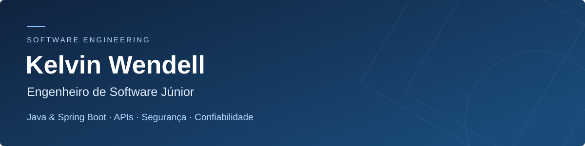
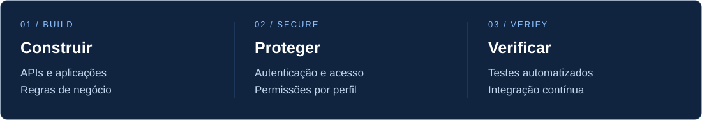

## Sobre mim

Sou **engenheiro de software júnior** e estudante de **Análise e Desenvolvimento de Sistemas na FIAP**. Atuo no desenvolvimento e aprimoramento de soluções administrativas, com atenção à estabilidade, à segurança e à experiência de quem utiliza os sistemas.

Meu foco técnico está no **backend com Java e Spring Boot**. Também tenho conhecimentos em desenvolvimento full stack e construo aplicações Android com Kotlin, conectando interfaces, APIs e dados às regras de negócio.

- **Backend:** desenvolvimento e consumo de APIs REST, orientação a objetos e integração com bancos de dados.
- **Full stack e mobile:** conhecimentos em React, Next.js e TypeScript, além de Kotlin e Jetpack Compose.
- **Qualidade e segurança:** testes automatizados, autenticação JWT e autorização por perfil nos meus projetos.
- **IA aplicada:** integração de modelos generativos para apoiar análises, com decisão humana e alternativa por regras.

<b>About me · English</b>

I'm a junior software engineer and a Systems Analysis and Development student at FIAP. I contribute to administrative software, focusing on stability, security and user experience.

My main technical focus is Java and Spring Boot backend development. I also have knowledge of React, Next.js and TypeScript, and build Android applications with Kotlin and Jetpack Compose. My projects explore automated testing, authentication, role-based authorization and practical AI integrations.

---

## Tecnologias e ferramentas

### Backend

### Frontend

### Mobile

### Bancos de dados

### Entrega, observabilidade e colaboração

### Qualidade e segurança

---

## Engenharia na prática

Nos projetos, procuro entender o problema antes de implementar, separar responsabilidades e testar os fluxos que sustentam a aplicação. A tecnologia entra para atender à necessidade do produto.

## Projeto em destaque

### Águia Inova · Gestão da inovação empresarial

Plataforma acadêmica que conecta **ideias de colaboradores**, **avaliação de gestores** e **acompanhamento de iniciativas pela liderança**.

> Colaborador → Ideia → Avaliação → Projeto → Acompanhamento

| Camada | Implementação |
|---|---|
| Backend | Java, Spring Boot e Spring Data MongoDB |
| Aplicativo | Kotlin, Jetpack Compose, MVVM, Repository e Retrofit |
| Segurança | Spring Security, JWT, BCrypt e autorização por perfil no servidor |
| Qualidade | JUnit, Testcontainers e Robolectric |
| Execução | Docker com build multiestágio, healthcheck e usuário sem privilégios de root |
| IA aplicada | Apoio à avaliação de ideias e geração de insights, com alternativa por regras |

**Decisões técnicas em destaque**

- **Continuidade do fluxo:** se o provedor de IA estiver indisponível, a avaliação segue por regras.
- **Controle de acesso:** permissões aplicadas na API conforme o perfil do usuário.
- **Testes com banco real:** integração com MongoDB por meio de Testcontainers.
- **Integrações organizadas:** interfaces e padrões como Strategy e Adapter para trabalhar com diferentes provedores de IA.

<b>Mais sobre arquitetura e implementação</b>

- Orientação a objetos com encapsulamento, herança, polimorfismo e abstração.
- Entidades com comportamento e responsabilidades definidas.
- Padrões Decorator, Template Method e Null Object nas integrações.
- Separação entre interface, acesso a dados e regras de negócio no aplicativo Android.
- IA como apoio à análise, mantendo a decisão com o usuário.

---

## Formação e aprendizado contínuo

| Formação | Instituição |
|---|---|
| Análise e Desenvolvimento de Sistemas — em andamento | FIAP |
| Java | FIAP |
| Orientação a objetos, coleções e consumo de APIs com Java | Alura |
| HTTP, redes e protocolos web | Alura |

<b>Áreas de interesse e desenvolvimento</b>

Backend, arquitetura de software, segurança de aplicações, observabilidade, confiabilidade e inteligência artificial aplicada ao negócio.

---

**Entender o problema. Construir com cuidado. Evoluir com evidências.**

Vamos conversar sobre desenvolvimento de software?

[LinkedIn](https://www.linkedin.com/in/kelvin-wendell-barboza-da-silva-4765a8216/) · [kelvinwendell.barboza@gmail.com](mailto:kelvinwendell.barboza@gmail.com)

